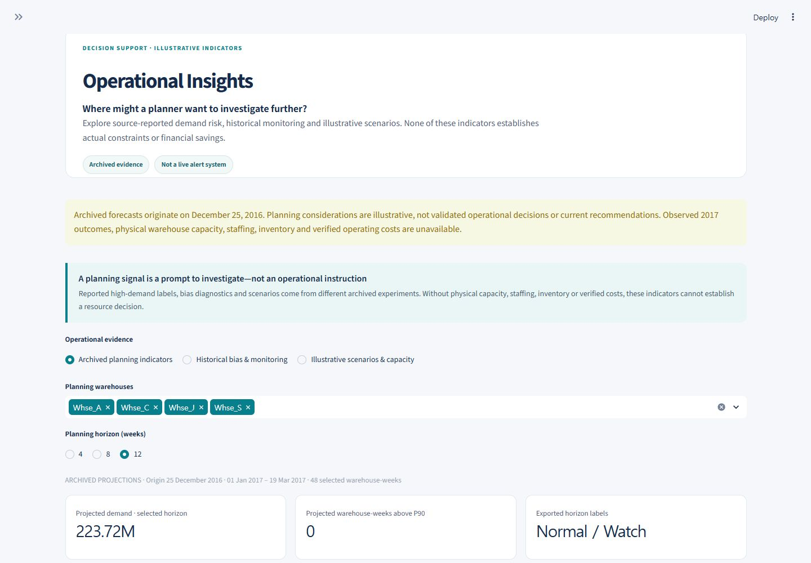
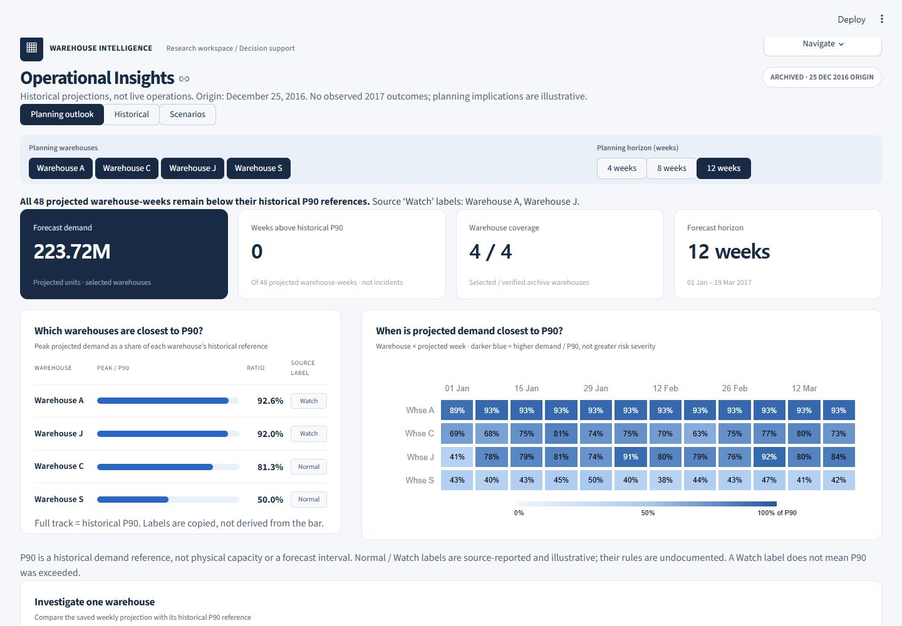
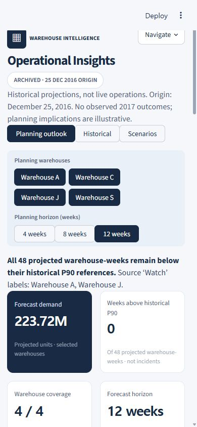
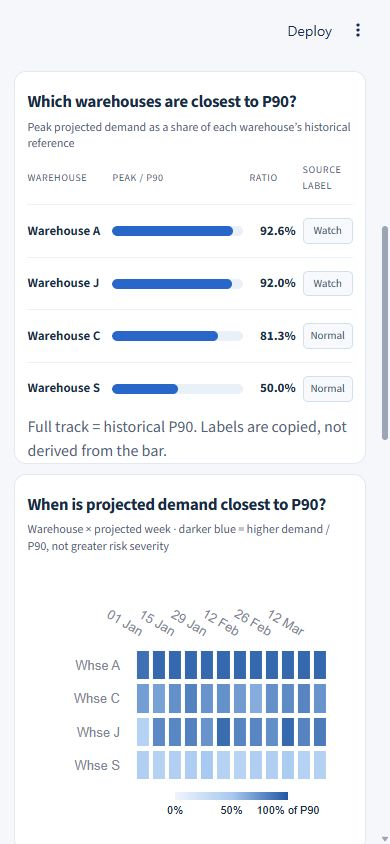

# Operational Insights product redesign — QA

October 16, 2026. The new design reference is **Operational Insights only**. Other
pages were not refactored. Their six renderers plus the pre-existing shared theme
match the SHA-256 snapshot recorded before this work.

## Delivered experience

- Full-width workspace, compact product navigation and archived-origin identity.
- Four source-derived KPIs near the top; a short selected-period finding.
- Warehouse and 4/8/12-week filters using native accessible pills/segmented controls.
- Warehouse peak/P90 comparison with original neutral Normal/Watch labels.
- Interactive warehouse-by-week heatmap replacing the four-line ratio plot.
- A warehouse selector and separate projected-demand / historical-P90 detail chart.
- Observed fact, archived projection and illustrative implication cards.
- Existing historical bias, monitoring, scenarios, illustrative capacity/loss and FVA
  analysis retained, with original filters and full-precision CSV downloads.
- Full tables, methods and repeated source details consolidated behind disclosures.

## Verified quantities

The full archive is 48 records: four warehouses × 12 weeks, Jan 1–Mar 19, 2017,
originating on **Dec 25, 2016**. No observed 2017 outcomes are supplied.

| Default 12-week KPI | Verified value |
|---|---:|
| Forecast demand | 223720550.875 projected units (displayed 223.72M) |
| Warehouse-weeks above historical P90 | 0 / 48 projected records |
| Selected warehouse coverage | 4 / 4 verified source warehouses |
| Forecast horizon | 12 weeks |

Peak ratios displayed in the comparison are A 92.6%, J 92.0%, C 81.3%, S 50.0%
of each warehouse's exported historical P90, rounded for display only. A/J are
source-labeled Watch at 12 weeks; all projected records remain below P90. Therefore
Watch is not presented as a P90-exceedance definition. These are neither operational
incidents nor measured capacity constraints.

The 4-week browser interaction changes the total to **69250338.375** units (69.25M),
the selected record count to 16, and the last projected date to Jan 22, 2017. Warehouse
detail controls update the projection, historical reference and evidence cards for
the selected warehouse. Source arithmetic still checks 48 weekly ratios, 72 operational
summary values and 36 forecast-summary values. No new risk score or forecast is computed.

## Automated checks

`python -m unittest discover -s tests -v`

**99 tests passed**: the 92 existing tests plus seven product redesign tests. Existing
interaction tests were adapted to the intended radio/multiselect → segmented/pill
control changes; their numerical, empty-state, missing-source and scenario assertions
remain. New checks verify all heatmap cells and hover fields, comparison values and
source categories, selected detail series, KPI/filter/empty-horizon states, downloads,
evidence distinctions, all six navigation destinations, scoped CSS, out-of-scope code
hashes and 4.5:1 heatmap annotation contrast throughout the color scale.

The test suite verifies all **87 original source hashes unchanged**. A separate final
hash audit confirms the same file count/set and digests. CSVs are read only, no models
are retrained and no source results are rewritten.

## Browser / responsive QA

The local Streamlit application starts successfully; the health endpoint returns
**HTTP 200 / ok**. An initial stale missing-module cache in the prior server was
resolved by restarting it before the baseline capture.

Desktop and mobile screenshots are actual browser captures, with explicit viewport
overrides and matching capture clips — no image resizing, artificial padding or
generated mockups. Saved JPEG dimensions are checked directly from the files.

| Screenshot | Actual image dimensions |
|---|---|
| Before desktop | 1440 × 1000 |
| After desktop | 1440 × 1000 |
| Mobile overview | 390 × 844 |
| Mobile analytical panels | 390 × 844 |

At 1440px, the workspace has **1376px usable content width**. At 390px, the page
scrollWidth equals clientWidth (390px), all four warehouse filter buttons are visible,
KPI cards form two columns, and the comparison/heatmap/detail panels each measure
351.22px and stack vertically. The mobile heatmap omits per-cell text annotations
but retains dates, warehouse labels, quantitative color legend and source-rich hover.
Desktop annotations use black/white chosen for contrast; colors never encode invented
severity categories. Browser interactions confirmed horizon updates and Warehouse J
investigation. These are responsive viewport tests, not physical-device user studies.

## Screenshots

Before, 1440px:

After, 1440px:

Mobile overview, 390px:

Mobile analytical panels, 390px:

## Limits and next review

P90 estimation history, quantile method and category rules remain undocumented.
Historical model/bias and scenario metadata gaps remain explicitly disclosed in their
own views. Forecasts are archived projections; no accuracy is calculated without 2017
actuals. There are no measured capacity, staffing, inventory or cost inputs. A normalized
demand/reference ratio cannot establish a resource decision, absence of risk or savings.

The design is structured for rapid stakeholder scanning, but the ten-second success
criterion has not been tested with a business-user study. Review this page as the new
reference before adopting components elsewhere. No other-page migration or deployment
has been performed.
