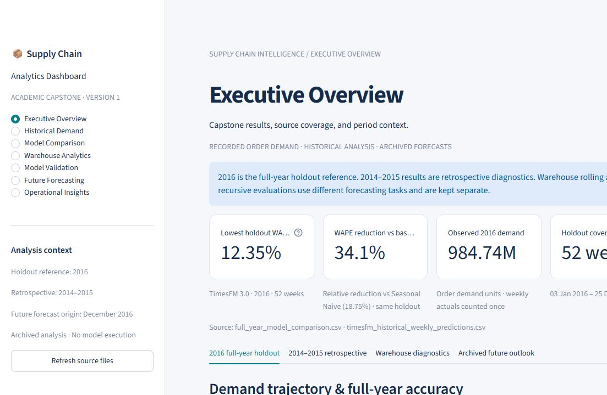
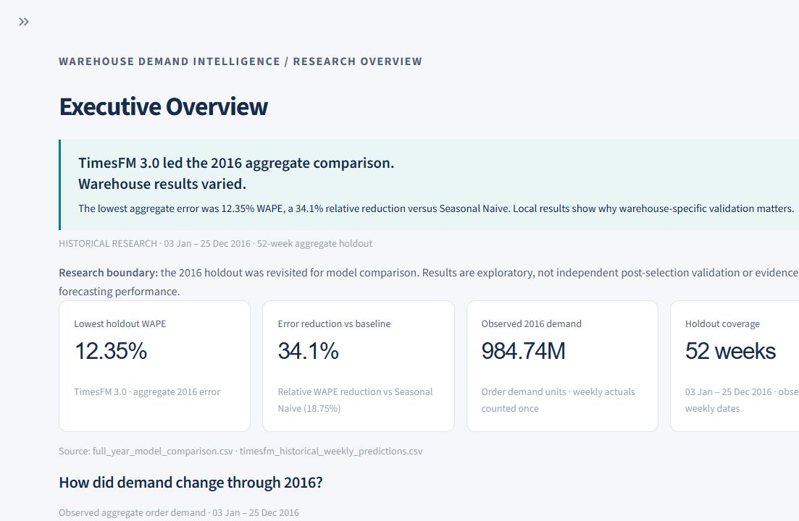
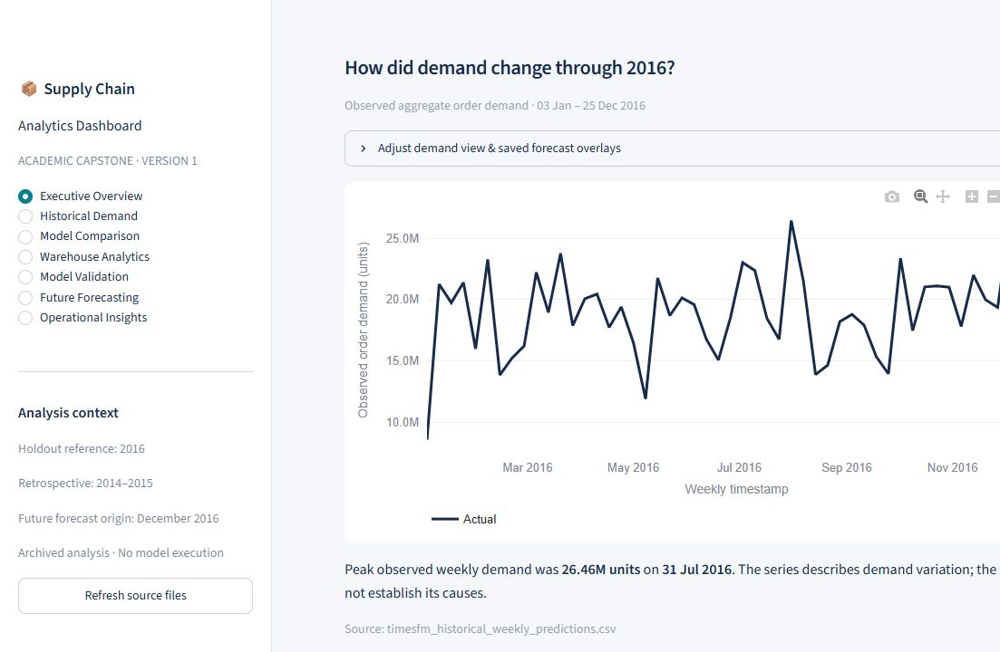
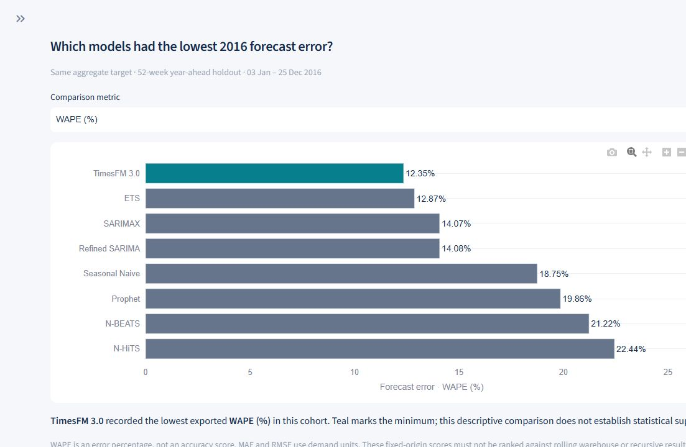

# Phase 3 — Executive Overview pilot QA

October 16, 2026. Scope: seven-page audit and design-system documentation, then
Executive Overview only. No deployment or other page redesign.

## Before / after

| Before | After |
|---|---|
| Generic introduction and protocol banner before findings | Concise source-derived research summary and visible evaluation boundary |
| Four tabbed analysis families hide local results | Main page presents demand, 2016 model errors and warehouse highlights |
| Demand and eight-model ranking compete in an uneven two-column row | Full-width question-led charts with readable labels and consistent styling |
| KPI context outside cards; labels can truncate | Four cards combine value/context; responsive equal-height layout |
| Multiple default forecast overlays | Actual-only default; saved forecasts available as labeled dashed overlays |
| Repeated visible technical prose and a PHASE 1 footer | Supporting analysis/methods/inventory on demand; concise current archive footer |
| Empty future selection displays zero | Empty selection displays unavailable; complete archive coverage checked first |

The original controls and CSV downloads remain, including all original archived
weekly source fields. Supplemental quarterly, retrospective-demand and planning-summary
downloads were added. Source tables retain full numerical precision. All primary
charts expose interactive hover, zoom, pan and PNG export without range sliders.
The other six renderers and their shared chart styling are unchanged.

## Verified headline figures

| Display | Unrounded source-derived value | Evidence |
|---|---:|---|
| Lowest holdout WAPE: 12.35% | 12.35084047543286% | full_year_model_comparison.csv, TimesFM 3.0 |
| Relative error reduction: 34.1% | 34.12862403256863% | (1 − TimesFM WAPE / Seasonal Naive WAPE) × 100, same 2016 cohort |
| Observed demand: 984.74M | 984736814 units | timesfm_historical_weekly_predictions.csv, 2016 Actual deduplicated by date |
| Coverage: 52 weeks | Jan 3–Dec 25, 2016 | Same weekly source; 52 distinct observed timestamps |

Warehouse highlights report each warehouse's own minimum rolling WAPE: Random Forest
for A/J, XGBoost for C/S. They do not create a cross-warehouse leaderboard. A/C/S
have 52 test weeks; J has 51. The aggregate year-ahead and warehouse rolling tasks
remain visibly separated. TimesFM/ETS difference is descriptive, not a significance
claim. Monthly chart axes explicitly describe weekly-timestamp grouping.

## Automated verification

`python -m unittest discover -s tests -v`

**92 tests pass**, including all 84 prior tests and 8 pilot additions. The additions
verify source-derived KPI values and narrative, exact metric order/values, tied minima,
observation-only defaults, labeled prediction overlays, monthly units, no range sliders,
download availability and retained fields, empty selections, all six navigation buttons,
partial-archive withholding and styling removal when navigating to specialist pages.
Text/background contrast pairs pass 4.5:1; categorical chart colors pass 3:1 against
white. Original source-file sets and SHA-256 hashes match for all **87** files.
The harmless bare-test Streamlit ScriptRunContext warning is not an application error.

## Browser and startup verification

Streamlit starts on http://127.0.0.1:8501; its health endpoint returns **HTTP 200 / ok**.
Browser checks confirmed the summary/KPIs, historical weekly/monthly filter, grouped-week
caveat, full-width eight-model chart and WAPE-to-RMSE selector (percentages change to
demand-unit labels). Saved comparison screenshots use the default WAPE view.

At a 1280px DOM viewport, measured content widths and responsive results were:

| Available Overview width | Setup | Measured KPI layout |
|---:|---|---|
| 1109px | Sidebar collapsed | Four cards, same row, 265.25px wide and equal 181.97px heights |
| 810px | Standard sidebar | Two cards per row, 397px wide and equal 159.58px heights |
| 511px | Sidebar temporarily widened | One column, 511px wide; chart/container reflow |

At each checked width, document scrollWidth equals clientWidth (1280px), with no
horizontal page overflow. Caption rendering is 14px and #526278. Source labels,
material caveats and native labeled controls remain available.

These are actual browser content-width checks, not mobile-device emulation. A separate
phone/touch and additional-browser review remains advisable before public release.
The screenshot provider captures a 1103 × 720 region of the 1280px DOM viewport, so
the right edge is cropped in the saved images; the DOM overflow check covers the
full viewport. The before view has its sidebar open, while the wide after view has
it collapsed to demonstrate the four-card layout.

## Screenshots

Before:

After:

Primary demand chart:

Model comparison:

## Recommendations pending design review

Review and approve this Overview pilot before migrating the design to the other six
pages. Proposed later priorities are a common chart theme, plain-language selectors,
consistent insight/source disclosures and fewer duplicate tables. Keep their existing
cohort and data-quality safeguards. Additional phone/browser testing and deployment
decisions remain later work. No research metadata gaps are resolved by this redesign.
Streamlit still eagerly computes charts in collapsed research disclosures; this pilot
does not claim a rendering-performance optimization.
